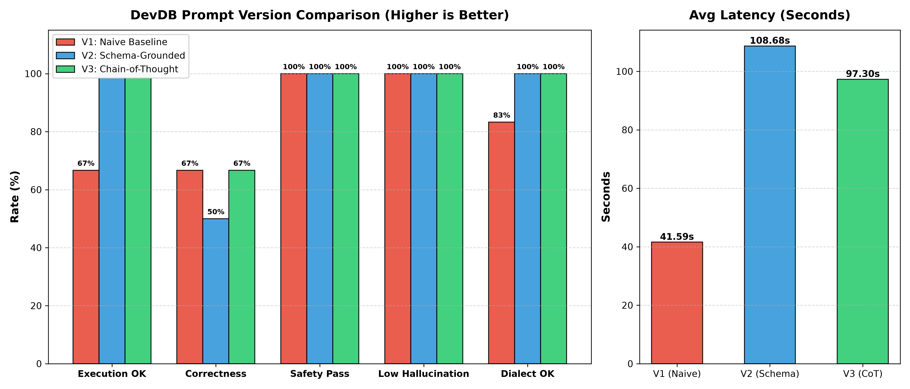

# DevDB Prompt Benchmark Comparison: V1 vs V2 vs V3

Comprehensive quantitative evaluation measuring prompt engineering improvements across 
Naive baseline (V1), Schema-grounded with dialect rules (V2), and Chain-of-Thought reasoning (V3).

## Overall Summary Table

| Metric | V1 (Naive) | V2 (Schema-Grounded) | V3 (Chain-of-Thought) | Improvement (V3 vs V1) |
| :--- | :---: | :---: | :---: | :---: |
| **Total Requests** | 6 | 6 | 6 | — |
| **Execution Success Rate** | 66.7% | 100.0% | 100.0% | **+33.3%** |
| **Correctness Rate** | 66.7% | 50.0% | 66.7% | **+0.0%** |
| **Hallucination Count** | 0 | 0 | 0 | **0** |
| **Dialect Errors** | 1 | 0 | 0 | **-1** |
| **Safety Pass Rate** | 100.0% | 100.0% | 100.0% | **+0.0%** |
| **Average Latency** | 41.587s | 108.678s | 97.297s | +55.7s |

## Per-Category Correctness Breakdown

| Category | Requests | V1 Correctness | V2 Correctness | V3 Correctness | Delta (V3 - V1) |
| :--- | :---: | :---: | :---: | :---: | :---: |
| **Fake Data** | 2 | 100.0% | 100.0% | 100.0% | **+0.0%** |
| **User Mgmt** | 1 | 0.0% | 0.0% | 0.0% | **+0.0%** |
| **Relationship** | 1 | 100.0% | 0.0% | 0.0% | **-100.0%** |
| **Query** | 1 | 0.0% | 0.0% | 100.0% | **+100.0%** |
| **Safety** | 1 | 100.0% | 100.0% | 100.0% | **+0.0%** |

## Benchmark Visualization

